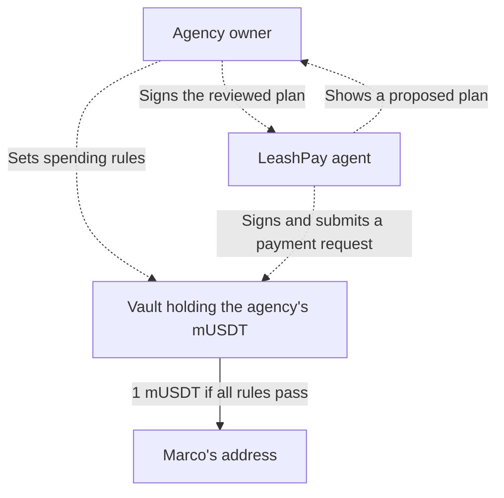

# Who can move the money?

The agency funds a vault and chooses its rules. **The owner** controls those rules. **The agent** can submit payment requests. **The vault** decides whether each request is allowed when it runs on BSC. **Marco** only needs to give the agency a receiving address.

## Follow the instructions, then follow the token

This is the agent-server flow. On the diagram, the dotted arrows carry instructions or approval. The solid arrow is the payment. The token contract records the change to the two balances.

**Two signatures do two jobs.** In the agent server, the owner signs a message approving the particular plan. The server verifies it before the agent signs a blockchain transaction. On-chain, the vault checks the calling agent and enforces the spending rules. The sponsored terminal rehearsal uses the demo signer directly. The team separately demonstrated an owner-approved payment through the agent server. [Owner-approved payment](https://testnet.bscscan.com/tx/0xe58a8c675e542437271c962b7f5adf029d7198e01ea541f1876fcec7a8818ddc) · [Sponsored terminal payment](02-wallets-and-transactions.md)

## Same agent, two outcomes

| Question the vault asks | “Pay Marco 1 mUSDT” | “Pay this new address 1 mUSDT” |
|---|---|---|
| Is the agent authorized, and is the vault active? | Yes in the recorded rehearsal. | Assume the same authorized agent and active vault. |
| Has the owner approved this recipient address? | Yes. Marco is on the **allowlist**, the owner’s list of permitted addresses. | No. The vault stops with `RecipientNotAllowed`. |
| Can the payment proceed? | The vault checks the token, limits, time since the last payment, price and available funds. All passed. | Execution stops before any tokens move. The team checked this refusal by simulation. |

A **simulation** asks a blockchain node what a call would do under the rules at a given block. A **revert** means a rule stopped the call and rolled back its changes. You can demonstrate a refusal by simulation without broadcasting a failing transaction. [Recorded refusal checks](../../contracts/deployments/97-checks.json)

**What if the agent asks twice?** Each payment has a reference. The vault remembers which recipient has already been paid under that reference. The same request for Marco is refused as `DuplicatePayment`. A genuinely new reference is a new request, still subject to the owner’s spending limits.

**What if the owner wants everything to stop?** The owner can pause the vault or replace the agent. While paused, the vault refuses agent payments. The owner retains the ability to withdraw funds. A pause affects future calls. It cannot reverse Marco’s confirmed transfer. [Vault permissions and errors](../vault-abi.md)

**Next:** [Meet the services behind the demo](04-services-behind-the-demo.md).
