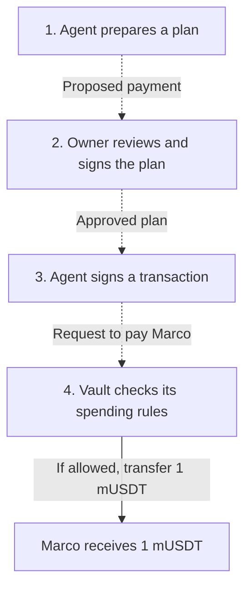

# Who can move the money?

Before payday, the **owner** puts test tokens in the vault, adds Marco’s address to the list of people the agency can pay, and sets spending limits. The **agent** is the software that prepares and submits payment requests. The agency’s money stays in the **vault** until its rules allow a transfer.

## Follow the instructions, then follow the token

Read down from “Pay Marco 1 USDT.” **Steps 1–3 pass instructions. If the rules pass at step 4, the vault sends the tokens.** On the practice network, the token for this request is mUSDT.

**Where can you see each signature?** At step 2 the owner approves the plan in their wallet. The LeashPay server checks that signed message. At step 3 the agent signs the transaction that goes to BSC. This is why BscScan lists the **agent** under **From**, even for a payment the owner approved in the app. [Payment made through the agent server](https://testnet.bscscan.com/tx/0xe58a8c675e542437271c962b7f5adf029d7198e01ea541f1876fcec7a8818ddc)

**Which steps does Marco’s annotated receipt show?** For the sponsored terminal rehearsal, start at **step 3**. The terminal used the demo agent’s key to send the request directly. The receipt shows the agent calling the vault and the vault paying Marco. The owner’s approval in step 2 belongs to the separate app flow above. [Read the annotated receipt](02-wallets-and-transactions.md#marcos-receipt-annotated)

## Same agent, two outcomes

| Question the vault asks | “Pay Marco 1 mUSDT” | “Pay this new address 1 mUSDT” |
|---|---|---|
| Is the agent authorized, and is the vault active? | Yes in the recorded rehearsal. | Assume the same authorized agent and active vault. |
| Has the owner approved this recipient address? | Yes. Marco is on the **allowlist**, the owner’s list of permitted addresses. | No. The vault stops with `RecipientNotAllowed`. |
| Can the payment proceed? | The vault checks the token, limits, time since the last payment, price and available funds. All passed. | Execution stops before any tokens move. The team checked this refusal by simulation. |

A **simulation** asks a blockchain node what a call would do under the rules at a given block. A **revert** means a rule stopped the call and rolled back its changes. You can demonstrate a refusal by simulation without broadcasting a failing transaction. [Recorded refusal checks](../../contracts/deployments/97-checks.json)

**What if the agent asks twice?** Each payment has a reference. The vault remembers which recipient has already been paid under that reference. The same request for Marco is refused as `DuplicatePayment`. A genuinely new reference is a new request, still subject to the owner’s spending limits.

**What if the owner wants everything to stop?** The owner can pause the vault or replace the agent. While paused, the vault refuses agent payments. The owner retains the ability to withdraw funds. A pause affects future calls. It cannot reverse Marco’s confirmed transfer. [Vault permissions and errors](../vault-abi.md)

**Next:** [Meet the services behind the demo](04-services-behind-the-demo.md).
